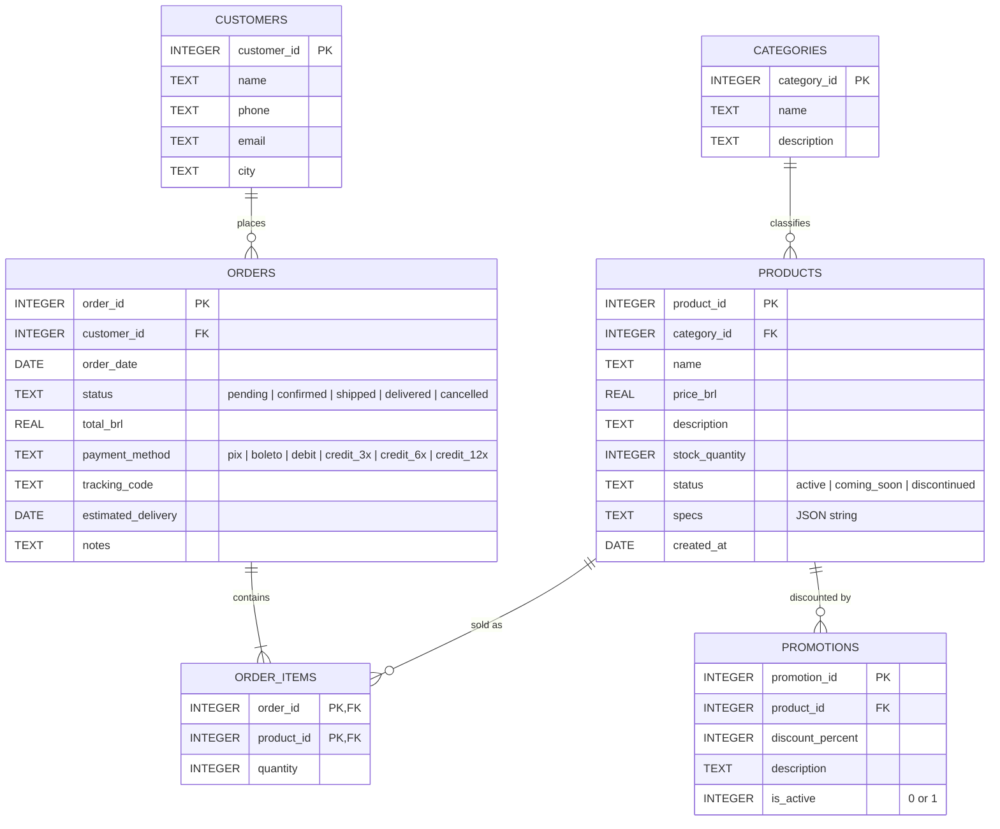

# music-store-agent

## Database Schema

### ER Diagram

### Tables

#### categories
| Column | Type | Constraints |
|---|---|---|
| category_id | INTEGER | PK |
| name | TEXT | NOT NULL |
| description | TEXT | |

#### products
| Column | Type | Constraints |
|---|---|---|
| product_id | INTEGER | PK |
| category_id | INTEGER | FK → categories.category_id |
| name | TEXT | NOT NULL |
| price_brl | REAL | NOT NULL |
| description | TEXT | |
| stock_quantity | INTEGER | NOT NULL |
| status | TEXT | `active`, `coming_soon`, `discontinued` |
| specs | TEXT | JSON object. Its keys vary by category. |
| created_at | DATE | |

#### promotions
| Column | Type | Constraints |
|---|---|---|
| promotion_id | INTEGER | PK |
| product_id | INTEGER | FK → products.product_id |
| discount_percent | INTEGER | 0–100 |
| description | TEXT | Campaign name, e.g. "Black Friday" |
| is_active | INTEGER | 0 or 1 |

#### customers
| Column | Type | Constraints |
|---|---|---|
| customer_id | INTEGER | PK |
| name | TEXT | NOT NULL |
| phone | TEXT | |
| email | TEXT | |
| city | TEXT | |

#### orders
| Column | Type | Constraints |
|---|---|---|
| order_id | INTEGER | PK |
| customer_id | INTEGER | FK → customers.customer_id |
| order_date | DATE | |
| status | TEXT | `pending`, `confirmed`, `shipped`, `delivered`, `cancelled` |
| total_brl | REAL | |
| payment_method | TEXT | `pix`, `boleto`, `debit`, `credit_3x`, `credit_6x`, `credit_12x` |
| tracking_code | TEXT | Nullable |
| estimated_delivery | DATE | Nullable |
| notes | TEXT | Nullable |

#### order_items
| Column | Type | Constraints |
|---|---|---|
| order_id | INTEGER | PK (part), FK → orders.order_id |
| product_id | INTEGER | PK (part), FK → products.product_id |
| quantity | INTEGER | NOT NULL |

The CSV has no surrogate id. `(order_id, product_id)` is unique in the data, so it works as a composite primary key.

### Relationships

| Parent | Child | Cardinality | FK |
|---|---|---|---|
| categories | products | 1 : N | products.category_id |
| customers | orders | 1 : N | orders.customer_id |
| orders | order_items | 1 : N (at least 1) | order_items.order_id |
| products | order_items | 1 : N | order_items.product_id |
| products | promotions | 1 : N | promotions.product_id |

`orders` and `products` have an M:N relationship, resolved through `order_items`.

### Notes and caveats

- **`customers.email` and `orders.tracking_code` are not `UNIQUE`**. There might be duplicate emails and many empty tracking codes (still has not shipped or canceled).
- **Several promotions can target one product.** For example, product 96 has two. Only `is_active = 1` rows should count as current.
- **`orders.total_brl` is stored, not calculated.** `order_items` doesn't save the price paid, so the total can't be recomputed from items and current prices.
- **`products.specs` is a JSON string.**
- Status and payment method are free text. **Not normalized.** 