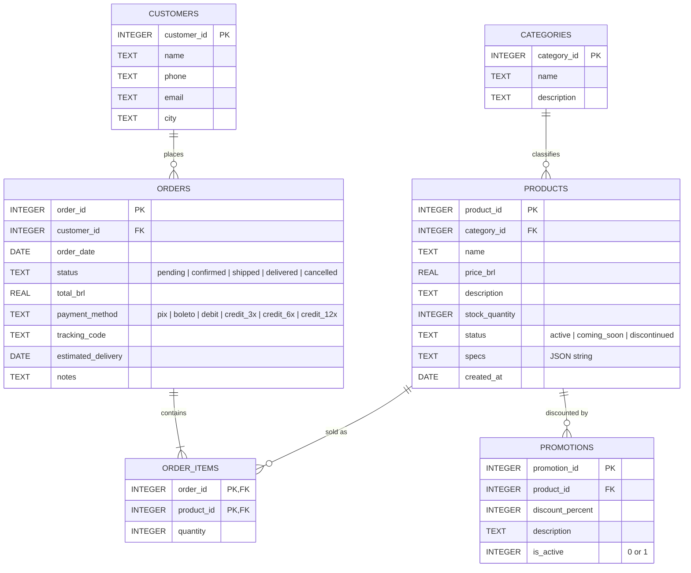

# music-store-agent

A customer-service Assistant for Empório da Música, a musical-instrument store in Campo Grande/MS (technical challenge: `desafio_tecnico_ai_eng_artefact.pdf`). It answers questions about the catalog, prices and promotions, a Customer's own Orders and the store's Policy Manual, and files Complaints. It replies in Brazilian Portuguese by default, and in the customer's language if they write in another one.

It has three parts:

| Folder | What it is |
|---|---|
| `backend/` | Python 3.12, FastAPI and LangChain v1. The agent, its tools, the streaming chat API, the seed script and the eval. See also [`backend/README.md`](backend/README.md). |
| `frontend/` | Vite, React, shadcn/ui and AI Elements. A chat page and a staff Complaints page, in `pt-BR` and `en`. |
| `bruno/` | A [Bruno](https://www.usebruno.com/) collection with a request for every endpoint. |

Read-only source data lives in `data/` (CSVs and the Policy Manual PDF). Domain vocabulary is in [`GLOSSARY.md`](GLOSSARY.md), the agreed design is in [`docs/design.md`](docs/design.md) and the hard-to-reverse decisions are in [`docs/adr/`](docs/adr/).

## Setup

### Prerequisites

- [uv](https://docs.astral.sh/uv/) (it installs Python 3.12 for you), [Node.js](https://nodejs.org/) and [pnpm](https://pnpm.io/).
- [Ollama](https://ollama.com/) for the local models and for the local embeddings.
- An OpenAI API key, only if you want the API model.

### 1. Models

```
ollama pull qwen3:4b    # default chat model
ollama pull qwen3:8b    # larger local chat model
ollama pull bge-m3      # embeddings for Policy Manual search, local mode
```

The API model, `gpt-6-luna`, is optional. To enable it, set `OPENAI_API_KEY` in `backend/.env` (next step). Without a key it is shown as unavailable in the interface and the rest works normally. Policy search for the API model uses OpenAI embeddings (`text-embedding-3-small`) and does not need Ollama.

The local models are the default because they are free: the whole project runs on a laptop with no account and no network after the pulls. A small GPU helps. `qwen3:4b` is the lighter of the two.

### 2. Backend

```
cd backend
uv sync
cp .env.example .env     # optional keys and overrides are described inside
uv run seed              # builds music_store.db from ../data
uv run uvicorn music_store.app:app --reload
```

The API listens on `http://localhost:8000`. The interactive docs are at `/docs`.

- `uv run seed` rebuilds the store tables (catalog, Customers and Orders) and keeps the Complaints. `uv run seed --reset` wipes everything, Complaints included.
- The most useful `.env` settings: `OPENAI_API_KEY`, `DEFAULT_MODEL` (one of the three model ids) and `REFERENCE_DATE` (see [Assumptions](#assumptions)).

### 3. Frontend

```
cd frontend
pnpm install
cp .env.example .env     # optional: VITE_API_URL, default http://localhost:8000
pnpm dev
```

Open `http://localhost:5173`. In the header, pick a Customer (or stay a Visitor) and a model, and chat. The Complaints page (`/complaints`) is the staff view of every filed Complaint.

Ideas to try: "Quais violões vocês têm até R$ 1000?", "Quanto custa o violão Takamine GD20?", "Qual é o endereço da loja?" (as a Visitor), and, as Pedro Henrique Oliveira (Customer 3), "Posso devolver o meu pedido 1?".

### Using the Bruno collection

Open the `bruno/` folder as a collection in Bruno and select the `local` environment (`baseUrl` is `http://localhost:8000`). It has requests for customers, models, chat (Visitor, Customer, Orders, Policy and Complaint), Complaints and the error cases. Chat requests stream Server-Sent Events. Send a second request with the same `conversation_id` to continue a conversation. Chat requests set the Customer with the `x-customer-id` header (drop it to be a Visitor). Add an `x-model` header to pick a model; without it the default is used.

### Tests and eval

```
cd backend
uv run pytest                      # no model calls, no network
uv run ruff check . && uv run ruff format --check .

cd ../frontend
pnpm typecheck && pnpm lint
```

The eval is separate from the tests. It needs a running server, and it plays 12 scenarios against each available model (the challenge questions, scope, safety and the Complaint flow):

```
cd backend
uv run uvicorn music_store.app:app    # in one terminal
uv run python -m evals                # in another; --model and --scenario narrow it down
```

Transcripts and a pass/fail table are saved to `backend/evals/transcripts/<timestamp>/` (git-ignored). The Complaint scenario files a real Complaint, so point the server at a throwaway database. More options are in [`backend/README.md`](backend/README.md#eval).

### Optional: LangSmith

To trace every Assistant run, set these in `backend/.env` and restart the server:

```
LANGSMITH_TRACING=true
LANGSMITH_API_KEY=<your key>
LANGSMITH_PROJECT=music-store-assistant
```

Tracing is off by default and is passed per request, not through process environment, so a missing key never breaks the chat.

## Database Schema

### ER Diagram



### Tables

#### categories
| Column | Type | Constraints |
|---|---|---|
| category_id | INTEGER | PK |
| name | TEXT | NOT NULL |
| description | TEXT | |

#### products
| Column | Type | Constraints |
|---|---|---|
| product_id | INTEGER | PK |
| category_id | INTEGER | FK → categories.category_id |
| name | TEXT | NOT NULL |
| price_brl | REAL | NOT NULL |
| description | TEXT | |
| stock_quantity | INTEGER | NOT NULL |
| status | TEXT | `active`, `coming_soon`, `discontinued` |
| specs | TEXT | JSON object. Its keys vary by category. |
| created_at | DATE | |

#### promotions
| Column | Type | Constraints |
|---|---|---|
| promotion_id | INTEGER | PK |
| product_id | INTEGER | FK → products.product_id |
| discount_percent | INTEGER | 0–100 |
| description | TEXT | Campaign name, e.g. "Black Friday" |
| is_active | INTEGER | 0 or 1 |

#### customers
| Column | Type | Constraints |
|---|---|---|
| customer_id | INTEGER | PK |
| name | TEXT | NOT NULL |
| phone | TEXT | |
| email | TEXT | |
| city | TEXT | |

#### orders
| Column | Type | Constraints |
|---|---|---|
| order_id | INTEGER | PK |
| customer_id | INTEGER | FK → customers.customer_id |
| order_date | DATE | |
| status | TEXT | `pending`, `confirmed`, `shipped`, `delivered`, `cancelled` |
| total_brl | REAL | |
| payment_method | TEXT | `pix`, `boleto`, `debit`, `credit_3x`, `credit_6x`, `credit_12x` |
| tracking_code | TEXT | Nullable |
| estimated_delivery | DATE | Nullable |
| notes | TEXT | Nullable |

#### order_items
| Column | Type | Constraints |
|---|---|---|
| order_id | INTEGER | PK (part), FK → orders.order_id |
| product_id | INTEGER | PK (part), FK → products.product_id |
| quantity | INTEGER | NOT NULL |

The CSV has no surrogate id. `(order_id, product_id)` is unique in the data, so it works as a composite primary key.

### Relationships

| Parent | Child | Cardinality | FK |
|---|---|---|---|
| categories | products | 1 : N | products.category_id |
| customers | orders | 1 : N | orders.customer_id |
| orders | order_items | 1 : N (at least 1) | order_items.order_id |
| products | order_items | 1 : N | order_items.product_id |
| products | promotions | 1 : N | promotions.product_id |

`orders` and `products` have an M:N relationship, resolved through `order_items`.

### Notes and caveats

- **`customers.email` and `orders.tracking_code` are not `UNIQUE`**. There might be duplicate emails and many empty tracking codes (still has not shipped or canceled).
- **Several promotions can target one product.** For example, product 96 has two. Only `is_active = 1` rows should count as current.
- **`orders.total_brl` is stored, not calculated.** `order_items` doesn't save the price paid, so the total can't be recomputed from items and current prices.
- **`products.specs` is a JSON string.**
- Status and payment method are free text. **Not normalized.** 