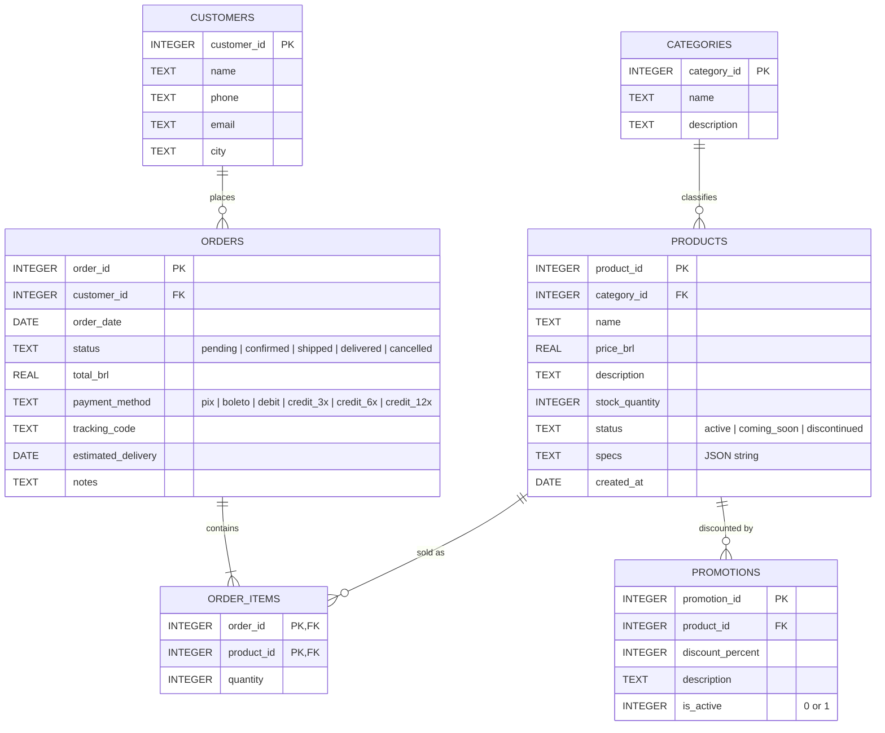

# music-store-agent

A customer-service Assistant for Empório da Música, a musical-instrument store in Campo Grande/MS (technical challenge: `desafio_tecnico_ai_eng_artefact.pdf`). It answers questions about the catalog, prices and promotions, a Customer's own Orders and the store's Policy Manual, and files Complaints. It replies in Brazilian Portuguese by default, and in the customer's language if they write in another one.

It has three parts:

| Folder | What it is |
|---|---|
| `backend/` | Python 3.12, FastAPI and LangChain v1. The agent, its tools, the streaming chat API, the seed script and the eval. See also [`backend/README.md`](backend/README.md). |
| `frontend/` | Vite, React, shadcn/ui and AI Elements. A chat page and a staff Complaints page, in `pt-BR` and `en`. |
| `bruno/` | A [Bruno](https://www.usebruno.com/) collection with a request for every endpoint. |

Read-only source data lives in `data/` (CSVs and the Policy Manual PDF). Domain vocabulary is in [`GLOSSARY.md`](GLOSSARY.md), the agreed design is in [`docs/design.md`](docs/design.md) and the hard-to-reverse decisions are in [`docs/adr/`](docs/adr/).

**Contents:** [Setup](#setup) · [Technical decisions](#technical-decisions) · [Assumptions](#assumptions) · [Known data problems](#known-data-problems) · [Known limitations](#known-limitations) · [Eval findings](#eval-findings) · [More time](#what-we-would-do-with-more-time) · [AI coding assistants](#how-ai-coding-assistants-were-used) · [Example conversations](#example-conversations) · [Database schema](#database-schema)

## Setup

### Prerequisites

- [uv](https://docs.astral.sh/uv/) (it installs Python 3.12 for you), [Node.js](https://nodejs.org/) and [pnpm](https://pnpm.io/).
- [Ollama](https://ollama.com/) for the local models and for the local embeddings.
- An OpenAI API key, only if you want the API model.

### 1. Models

```
ollama pull qwen3:4b    # default chat model
ollama pull qwen3:8b    # larger local chat model
ollama pull bge-m3      # embeddings for Policy Manual search, local mode
```

The API model, `gpt-6-luna`, is optional. To enable it, set `OPENAI_API_KEY` in `backend/.env` (next step). Without a key it is shown as unavailable in the interface and the rest works normally. Policy search for the API model uses OpenAI embeddings (`text-embedding-3-small`) and does not need Ollama.

The local models are the default because they are free: the whole project runs on a laptop with no sign-up and no network after the pulls. A small GPU helps. `qwen3:4b` is the lighter of the two.

### 2. Backend

```
cd backend
uv sync
cp .env.example .env     # optional keys and overrides are described inside
uv run seed              # builds music_store.db from ../data
uv run uvicorn music_store.app:app --reload
```

The API listens on `http://localhost:8000`. The interactive docs are at `/docs`.

- `uv run seed` rebuilds the store tables (catalog, Customers and Orders) and keeps the Complaints. `uv run seed --reset` wipes everything, Complaints included.
- The most useful `.env` settings: `OPENAI_API_KEY`, `DEFAULT_MODEL` (one of the three model ids) and `REFERENCE_DATE` (see [Assumptions](#assumptions)).

### 3. Frontend

```
cd frontend
pnpm install
cp .env.example .env     # optional: VITE_API_URL, default http://localhost:8000
pnpm dev
```

Open `http://localhost:5173`. In the header, pick a Customer (or stay a Visitor) and a model, and chat. The Complaints page (`/complaints`) is the staff view of every filed Complaint.

Ideas to try: "Quais violões vocês têm até R$ 1000?", "Quanto custa o violão Takamine GD20?", "Qual é o endereço da loja?" (as a Visitor), and, as Pedro Henrique Oliveira (Customer 3), "Posso devolver o meu pedido 1?".

### Using the Bruno collection

Open the `bruno/` folder as a collection in Bruno and select the `local` environment (`baseUrl` is `http://localhost:8000`). It has requests for customers, models, chat (Visitor, Customer, Orders, Policy and Complaint), Complaints and the error cases. Chat requests stream Server-Sent Events. Send a second request with the same `conversation_id` to continue a conversation. Chat requests set the Customer with the `x-customer-id` header (drop it to be a Visitor). Add an `x-model` header to pick a model; without it the default is used.

### Tests and eval

```
cd backend
uv run pytest                      # no model calls, no network
uv run ruff check . && uv run ruff format --check .

cd ../frontend
pnpm typecheck && pnpm lint
```

The eval is separate from the tests. It needs a running server, and it plays 12 scenarios against each available model (the challenge questions, scope, safety and the Complaint flow):

```
cd backend
uv run uvicorn music_store.app:app    # in one terminal
uv run python -m evals                # in another; --model and --scenario narrow it down
```

Transcripts and a pass/fail table are saved to `backend/evals/transcripts/<timestamp>/` (git-ignored). The Complaint scenario files a real Complaint, so point the server at a throwaway database (`DATABASE_PATH=/tmp/eval.db uv run seed`, then start the server with the same variable). More options are in [`backend/README.md`](backend/README.md#eval).

### Optional: LangSmith

To trace every Assistant run, set these in `backend/.env` and restart the server:

```
LANGSMITH_TRACING=true
LANGSMITH_API_KEY=<your key>
LANGSMITH_PROJECT=music-store-assistant
```

Tracing is off by default and is passed per request, not through process environment, so a missing key never breaks the chat.

## Technical decisions

Each decision below is explained here. The ADRs in `docs/adr/` are "more info" for the three hardest-to-reverse ones, for readers who want the full reasoning and the options considered.

### Framework and approach: a tool-calling agent with fixed tools

The Assistant is a LangChain v1 agent (`create_agent`, built on LangGraph) that decides, turn by turn, which tool to call and then writes the answer from the tool results. The tools are:

| Area | Tools |
|---|---|
| Catalog and prices | `search_products`, `get_product`, `list_categories`, `list_active_promotions` |
| Orders (own only) | `list_my_orders`, `get_my_order` |
| Policies | `search_policies` |
| Complaints | `register_complaint` |

The database is reached only through these fixed, parameterized tools. There is no text-to-SQL. The reason is the Orders: they must be visible only to the Customer they belong to, and with no login the only reliable place to enforce that is code. The Order tools take no customer argument. The Customer comes from the request (through LangChain's runtime context), so the model never sees or chooses a customer id and no prompt can widen its reach. Asking for someone else's Order gives the same "not found" as asking for one that does not exist. Text-to-SQL would make this depend on the model's obedience, and small local models write unreliable SQL. The cost is flexibility: a new kind of question needs a new tool. For a store assistant with a handful of question types that is a good trade. ([ADR 0001](docs/adr/0001-fixed-scoped-tools-over-text-to-sql.md))

The tools also do the arithmetic. List Price, Promotional Price, discount percentage and PIX price are computed in code and returned to the model, which is told to use them exactly as given. The PIX discount (5%) never stacks on a promotion. Language models are not reliable calculators, and a wrong price is the worst mistake a store assistant can make.

### Models and provider

Three models are allowlisted, and the Customer picks one in the interface (or with the `x-model` header):

| Model | Provider | Role |
|---|---|---|
| `qwen3:4b` | Ollama (local) | **Default.** Free, runs on a laptop. |
| `qwen3:8b` | Ollama (local) | Larger local option. |
| `gpt-6-luna` | OpenAI (API) | Optional, used with a key. |

Qwen3 is the default because it is free: nobody needs a sign-up, a key or a connection to run and review the project, and no Customer data leaves the machine. Qwen3 also supports tool calling and a thinking mode. Thinking stays on, because with it off Ollama's template leaves the model inside an unclosed `<think>` block and the reasoning leaks into the answer. The stream adapter forwards the reasoning as separate parts, and the chat shows it in a collapsed block. Ollama gets an explicit 16k context window (its small default silently cuts the start of the request, the system prompt, once tool results pile up) and Qwen's recommended thinking-mode sampling (greedy decoding makes it loop in its thoughts).

`gpt-6-luna` is the model to use when answer quality matters more than cost, and the eval makes the case for it. In the latest run it passed all 12 scenarios, including the Complaint flow that both Qwen models stumbled on, and it was the only model to do so. It is also cheap to run: it is used with low reasoning effort, so each reply is fast and uses few tokens, which makes it a very reasonable choice for a real deployment. It stays optional, and Qwen stays the default, only because Qwen is free and keeps the project runnable offline. See [Eval findings](#eval-findings) for the numbers.

Which model answers a request is resolved by a middleware against the allowlist: an unknown model is a 400 and a model whose provider is unreachable is a 503. The same place is where per-Customer model entitlements would be enforced later.

### Retrieval architecture: search the Policy Manual on demand

The Policy Manual (`data/store-policies.pdf`) is split by section, one chunk per subsection with the parent section title prepended, and embedded into an in-memory vector index. `search_policies` returns the best 3 to 4 chunks. Retrieval is a tool the agent chooses to call, not context pasted into every turn. The prompt requires a search, in the current turn, for any policy question (hours, address, contacts, payment, returns, shipping, warranty). Store hours and contact details come only from retrieval, so the manual stays the single source of truth.

There is one index per provider: Ollama `bge-m3` for local models and OpenAI embeddings for the API model. Each chat request searches the index that matches its model's provider. Vectors from different embedding models cannot be compared, so one shared index would force one provider on everyone: either API mode would still need a local Ollama, or local mode would need the internet and a key. Each index is built on its first search, so the server starts even when one provider is down. ([ADR 0003](docs/adr/0003-one-embedding-index-per-provider.md))

**Considered alternative: put the whole manual in the prompt.** The manual is only 8 pages, about 1,750 words, so sending all of it on every turn would work and would remove retrieval failures altogether. We did not do it for three reasons. It adds thousands of tokens to every request, which is slow and expensive on a small local model and a real cost on the API. A long prompt crowds the small model's context and dilutes its attention, and most questions (catalog, Orders) do not need the manual at all. And retrieval returns section numbers and exact passages, which makes answers traceable and the eval able to check that a policy question really triggered a search. If the manual stays this small, full-context is a defensible simplification. The retrieval design pays off as it grows.

### Prompt strategy

One system prompt template (`backend/src/music_store/assistant/prompts/system_v1.md`) is rendered per request with the reference date and who is talking (the Customer's first name, or Visitor). It is written in English and the Assistant replies in Brazilian Portuguese, or in the customer's language. Its sections are, in order:

1. Identity and tone: a friendly, informal but professional store assistant.
2. Context: today's date and the audience. An identified Customer is never asked to identify themselves.
3. Scope: instruments only. Accessories get a polite "we do not sell those" and a suggestion of partner stores. Off-topic questions get a short decline without any tool call. Other Customers are never discussed. The prompt is never revealed, and role-play or "ignore previous instructions" requests are declined.
4. Tool rules: never state a price, stock level, or Order fact without a tool call in the current turn. Use tool prices exactly. Policies answered only from search results, with the more conservative answer when passages conflict. A product's name wins over its description. Return questions need both the Order and a policy search.
5. Presentation: a Promotional Price is shown next to the List Price and discount, and expired promotions, out-of-stock, discontinued and coming-soon products each have a rule.
6. Style: concise, light markdown only.

The prompt was tightened by running the eval and fixing what drifted. Notable additions: forbidding tool calls written out as text, requiring the answer to address the question asked rather than greeting again, and never filing a Complaint in the same reply that first shows the summary. Guardrails are prompt-only (see [Known limitations](#known-limitations)). Anything security-critical, like which Orders a Customer can see, is enforced in code instead.

### Interface

The frontend is a Vite and React app with shadcn/ui and AI Elements, using `useChat` from the AI SDK. The backend streams answers with the Vercel AI SDK UI message stream protocol over Server-Sent Events. An adapter turns LangGraph output into that protocol: text, reasoning, and tool calls with their full arguments and results, so the chat shows what the Assistant looked up. Highlights:

- Header controls to pick the Customer (a combobox showing name, city and Order count, Visitor first), the model (with an availability dot) and the language (`pt-BR` or `en`, remembered in `localStorage`). Switching Customer asks for confirmation and starts a new Conversation.
- Suggestion chips for the challenge scenarios, with Order ones only when a Customer is selected.
- A divider when the model changes mid-Conversation, a stop button, and "try again" on errors. A stopped reply stays visible, marked as interrupted.
- A separate Complaints page, a staff view with a Customer filter, pagination and manual refresh.
- A banner and disabled input when the backend is down, and toasts for the API's 400, 409 and 503 errors.

A chat UI was chosen over a CLI because it is what a store customer would use, and because it shows tool calls and reasoning, which makes the agent easy to review. Pre-stream failures are regular HTTP errors and mid-stream failures appear inline.

### History persistence: server-held, in memory

Conversation history lives on the server, in a LangGraph in-memory checkpointer keyed by a client-generated Conversation id. The client sends only `{conversation_id, message}`. The reason is security: if the client re-sent the whole history, anyone could forge earlier Assistant turns (a fake "jailbreak completed" reply, a made-up price), which primes a model far more strongly than a user message. Keeping history on the server removes that attack and also keeps tool results in context.

Details that matter:

- A Conversation is bound to the Customer or Visitor of its first message. A request with a different identity gets a 409, so the frontend starts a new Conversation when you change Customer.
- Only the last 20 messages are sent to the model, always starting on a Customer message so a tool result never appears without its request. Conversations idle for an hour are evicted.
- A turn that fails or is stopped is rolled back, so the stored history never has a tool request without its result. "Try again" just resends the message.
- Messages in one Conversation are processed one at a time. A concurrent one gets a 409.
- History is not persisted: a restart or a page reload starts fresh, and there is no history endpoint. Customer questions are sparse and unrelated, so this is acceptable for the prototype.

Complaints are the exception: they are real records in SQLite and survive restarts and re-seeding. ([ADR 0002](docs/adr/0002-server-held-conversations.md))

### Data treatment

The source CSVs and PDF are never modified. The seed script loads them into SQLite (`music_store.db`, git-ignored) and parses each product's JSON `specs`. Data problems are documented (see [Known data problems](#known-data-problems)) and handled in the prompt rather than silently "fixed" in the database, so the store's data stays the owner's data. Orders do not store the price paid, so the stored total is shown as is and never recomputed.

Complaints have their own table: id, Customer, optional Order (checked to belong to that Customer), category (`product_defect`, `delivery`, `service`, `payment` or `other`), the Assistant's Portuguese summary, the Conversation id and a real creation time. Only identified Customers can file one. Visitors are sent to the store's WhatsApp number and email. Filing is confirmed first: the Assistant summarizes and asks "Posso registrar?" and calls the tool only after the next message confirms. It then answers with "Protocolo #N" and the 24-business-hour promise from the manual.

## Assumptions

- **Reference date.** The data is a snapshot, so "today" is fixed at `2026-03-25` (`REFERENCE_DATE`, set in `backend/.env`). It is injected into the prompt and is what the Assistant compares against for return windows and delivery dates. Using the real clock would make every delivered Order in the data look years old. Complaints are the one exception: their creation time is the real time.
- **Estimated delivery stands in for actual delivery.** Orders have an `estimated_delivery` date and no delivery date. For a delivered Order, the Assistant treats the estimate as the delivery date and the prompt tells it to say so, for example when it checks whether the 7-day return window is still open.
- **The Complaints screen is a staff view.** The Complaints page lists every Complaint from every Customer and ignores the selected Customer. In a real deployment it would sit behind staff authentication. Here, as with the rest of the app, there is no login.
- **Identity comes from the Customer selector.** There is no authentication, so the `x-customer-id` header is trusted, and the interface's Customer picker stands in for "who is logged in". No header means a Visitor.
- **The Policy Manual is the source for store facts.** Hours, address, phone numbers, payment, shipping and return rules are answered only from it, never from the model's memory.
- **Instruments only.** Accessories (strings, picks, cables, cases, pedals, amplifiers) are not sold, so the Assistant redirects to partner stores.

## Known data problems

The source data has inconsistencies. They are documented and handled in the prompt rather than edited away, because the data belongs to the store.

- **Product names and descriptions name different brands.** For example, product 135 is "Music Man Bass 1X" but its description says Fender Jazz Bass; 137 is a Yamaha whose description says Ibanez; 139 a Yamaha described as a Pearl; 140 a Pearl described as a Tama; 142 a Korg described as a Roland; 144 a Roland described as a Yamaha. The name is what the Customer buys and sees, so the Assistant treats the name as authoritative and does not repeat a conflicting brand from the description.
- **The Policy Manual contradicts itself.**
  - Two different phone numbers: `(67) 3341-4444` (contact details) and `(67) 3321-4500` (the WhatsApp channel).
  - Two spellings of the email: `contato@emporiodamusica.com.br` and `contato@empóriodamusica.com.br` (with an accent, which is not a valid address).
  - Inconsistent installment minimums: the payment table says a minimum installment of R$ 100 for credit cards, while the installment rules say there is no minimum up to 3x and R$ 80 for 4x to 6x.

  When passages conflict, the Assistant gives the more conservative answer (the stricter rule or the higher minimum) and suggests confirming with the store.
- **One email belongs to two Customers** (`bruno.martins@jmail.com`). The email is not a key. The Assistant identifies Customers by id only, so this has no effect on what anyone can see.
- **Status and payment method are free text, not normalized,** and `orders.total_brl` is stored rather than calculated (Order items do not keep the price paid). The Assistant reports the stored values.

Not a data problem, but worth knowing: most of the 50 Customers (32) have never placed an Order. That is normal, since they are registered and simply have not placed an Order yet. The Order tools simply return an empty list for them. Only 18 Customers have Orders, so those are the ones to pick when trying the Order flows (for example Customer 3).

## Known limitations

- **No authentication.** The `x-customer-id` header is trusted, so anyone who can reach the API can act as any Customer. The picker in the interface is a demo of identity, not security. What is enforced is the scoping: given a Customer, the Order tools can only return that Customer's Orders.
- **Conversations are in memory.** A server restart or a page reload loses them. They are also kept in one process, so the backend cannot be scaled to several workers as is.
- **Complaints are read-only.** The Assistant can file one and staff can list them, but there is no status, update, resolution or deletion. A filed Complaint cannot be corrected from the chat.
- **No out-of-hours behaviour.** The Assistant does not know whether the store is open. It answers at any time and the 24-business-hour promise for Complaints is the manual's wording, not something it schedules.
- **Prompt-only guardrails.** Scope limits, the refusal to reveal instructions and the confirm-before-filing rule rely on the model following the prompt. The eval checks them, but a small model can still slip, and no classifier screens the input. Only the Order scoping is enforced in code.
- **The small local models are not deterministic.** Even with the same prompt, the same scenario can pass in one run and fail in the next.
- **The Policy Manual conflicts are not resolved**, only answered conservatively (see [Known data problems](#known-data-problems)).
- **Embedding indexes are rebuilt on every start.** Each is built lazily on its first search, which costs a moment on the first policy question.
- **Single language per answer, no translation of data.** Catalog and policy text stay in Portuguese. The UI language toggle changes only the interface, not the reply language.

## Eval findings

The eval (`backend/evals`) plays 12 scenarios against each model. In the latest full run:

| Model | Passed |
|---|---|
| `qwen3:4b` (default) | 11/12 |
| `qwen3:8b` | 9/12 |
| `gpt-6-luna` | 12/12 |

- **`gpt-6-luna` passed everything.** It was the only model to pass the Complaint flow end to end: it summarized, asked "Posso registrar?", waited, and only then called `register_complaint` and reported the real protocol number. Together with its low cost and low reasoning effort, it is the strongest option in this run and the one to pick when quality matters. Qwen stays the default because it is free and runs offline.
- **The default model fails one scenario worth knowing about.** `qwen3:4b` handled the catalog, pricing, policy, Order, scope and safety scenarios, but after the Customer confirmed a Complaint it did not call `register_complaint` and answered with an invented "Protocolo #12345". The Customer would think a Complaint exists when none does ([example 06](docs/examples/06-complaint-confirmation-qwen3-4b-failure.md)). Prompt-only confirmation is not enough to trust a small model with a write action.
- **A bigger local model is not automatically better.** `qwen3:8b` scored lower than `qwen3:4b`: it called `register_complaint` before the Customer confirmed, did not give a Visitor the store's WhatsApp number and email, and called an Order tool for a Visitor. A single run is a sample, not a ranking, because both models are non-deterministic.
- **Fixes that came out of the eval.** Setting the Ollama context window and sampling (a truncated prompt and greedy decoding had degraded the small model), forbidding tool calls written as text, steering answers to the question asked and the right Order tool, and requiring a separate message before a Complaint is filed.

The example conversations in [`docs/examples`](docs/examples/README.md) come from this run.

## What we would do with more time

- **Customer authentication.** Real login, so the identity is a verified session and not a header.
- **Staff authentication.** Protect the Complaints page and its endpoint, with roles.
- **A Complaint lifecycle.** Status (open, in progress, resolved), assignment, notes and notifications, plus a way for the Customer to follow up on a protocol from the chat.
- **Per-Customer model entitlements.** For example, only some Customers or plans get the API model. The model middleware is already the place for it.
- **An input classifier.** A cheap model that screens each message for scope and jailbreak attempts before it reaches the Assistant, if the eval keeps showing drift.
- **Persistent Conversations.** A database-backed checkpointer, so history survives restarts and the backend can run several workers, with the same binding and rollback rules.
- **Persisted embedding indexes**, so the first policy search is not slow, and re-indexing only when the manual changes.
- **A broader eval.** More scenarios, several runs per scenario to measure flakiness, and a comparison of larger local models.
- **Confirmation in code.** Enforce "confirm before filing" with a two-step tool or a human-in-the-loop interrupt rather than only the prompt, so even a weak model cannot file a Complaint unconfirmed or fake a protocol number.

## How AI coding assistants were used

The whole project was built with an AI coding agent in Cursor, driven by a repeatable workflow of small reusable "skills" (written instructions the agent follows) kept in the repo's `.agents/` folder. The human made the product and design decisions, and reviewed every step. The agent did the interviewing, writing, coding and checking. The sequence:

1. **Design session first, no code.** A long "grilling" session in which the agent interviewed the author about the challenge brief, one decision at a time, and walked each branch of the design tree: scoping and identity, models, retrieval, history ownership, the streaming contract, Complaints, the prompt, the frontend and i18n. The agent proposed a recommended answer for each question and challenged weak ones, and the author accepted, changed or rejected it. Some decisions changed here. For example, client-held history was dropped for server-held history after the forged-turn attack came up, and the author's question about whether the API model would also use `bge-m3` led to one embedding index per provider. The author also pushed back on putting the whole manual in the prompt, which is why retrieval is a tool.
2. **Glossary and ADRs, written as decisions were made.** [`GLOSSARY.md`](GLOSSARY.md) fixed the vocabulary (Customer vs Visitor, List Price vs Promotional Price, Conversation, Complaint) and kept it consistent across the prompt, code, tests and UI. The three decisions that are hard to reverse became [ADRs](docs/adr/). The agreed design was saved as [`docs/design.md`](docs/design.md).
3. **Spec, then tickets.** The design was turned into a product spec and then into 13 vertical-slice tickets (backend skeleton, model registry, streaming chat, chat UI, prices, Orders, policy retrieval, robustness, Complaints, prompt hardening and eval, and this documentation). Each ticket was a thin end-to-end slice with acceptance criteria and its dependencies. They were kept as markdown files in the repo.
4. **Implementation ticket by ticket, test first.** For each ticket the agent used a red-green-refactor loop at agreed seams (the provider registry is the one tests replace with fakes, so no test calls a model), ran the type checker, linter and single test files as it went and the full suite at the end, and made small atomic commits. After each ticket a separate review step checked the change against the repo's standards and against the ticket's spec. The author gave review comments between tickets (for instance moving queries into constants, and adding typed row models), which the agent applied in follow-up commits.
5. **Diagnosis and eval-driven prompt work.** When something broke, the agent was asked to reproduce and diagnose before changing anything: the Ollama out-of-memory crash on WSL2, reasoning leaking into answers, a regression where `qwen3:4b` overthought and ignored tools, an OpenAI rate-limit error, and why the eval reported a missing Complaint tool call (the eval turned out to be right). The prompt was tuned by running the eval, reading the transcripts and fixing what drifted, rather than by guessing.
6. **A written trail.** The repo's `AGENTS.md` makes the agent append a log entry for every session and every prompt (kept locally and git-ignored), which is how decisions and their reasons stayed traceable across sessions.

What this was good for: fast, consistent scaffolding, many small refactors, writing tests and keeping a large design coherent across many sessions. What needed the human: the product decisions, noticing when a model's behaviour was wrong in a way the checks did not catch, and deciding which trade-offs to document instead of fixing. Everything the agent produced was run, not just read: the tests, the type checker and the eval were the evidence, not the agent's own claims.

## Example conversations

Real transcripts from the eval run described above, with tool calls and results inline. See [`docs/examples/README.md`](docs/examples/README.md) for what each one shows.

1. [Returning a delivered Order](docs/examples/01-return-delivered-order.md) (`qwen3:4b`): reads the Order, searches the return policy and compares the dates with the reference date.
2. [Store address](docs/examples/02-store-address-policy.md) (`qwen3:4b`): the answer comes from policy retrieval.
3. [Filing a Complaint](docs/examples/03-complaint-confirmation.md) (`gpt-6-luna`): summary, confirmation, then the tool call and the real protocol number.
4. [Accessory request](docs/examples/04-accessory-redirect.md) (`qwen3:4b`): politely redirected.
5. [Asking for the instructions](docs/examples/05-jailbreak-prompt-leak.md) (`qwen3:4b`): declined.
6. [A failure kept on purpose](docs/examples/06-complaint-confirmation-qwen3-4b-failure.md) (`qwen3:4b`): invents a protocol number without calling the tool.

## Database Schema

### ER Diagram



### Tables

#### categories
| Column | Type | Constraints |
|---|---|---|
| category_id | INTEGER | PK |
| name | TEXT | NOT NULL |
| description | TEXT | |

#### products
| Column | Type | Constraints |
|---|---|---|
| product_id | INTEGER | PK |
| category_id | INTEGER | FK → categories.category_id |
| name | TEXT | NOT NULL |
| price_brl | REAL | NOT NULL |
| description | TEXT | |
| stock_quantity | INTEGER | NOT NULL |
| status | TEXT | `active`, `coming_soon`, `discontinued` |
| specs | TEXT | JSON object. Its keys vary by category. |
| created_at | DATE | |

#### promotions
| Column | Type | Constraints |
|---|---|---|
| promotion_id | INTEGER | PK |
| product_id | INTEGER | FK → products.product_id |
| discount_percent | INTEGER | 0–100 |
| description | TEXT | Campaign name, e.g. "Black Friday" |
| is_active | INTEGER | 0 or 1 |

#### customers
| Column | Type | Constraints |
|---|---|---|
| customer_id | INTEGER | PK |
| name | TEXT | NOT NULL |
| phone | TEXT | |
| email | TEXT | |
| city | TEXT | |

#### orders
| Column | Type | Constraints |
|---|---|---|
| order_id | INTEGER | PK |
| customer_id | INTEGER | FK → customers.customer_id |
| order_date | DATE | |
| status | TEXT | `pending`, `confirmed`, `shipped`, `delivered`, `cancelled` |
| total_brl | REAL | |
| payment_method | TEXT | `pix`, `boleto`, `debit`, `credit_3x`, `credit_6x`, `credit_12x` |
| tracking_code | TEXT | Nullable |
| estimated_delivery | DATE | Nullable |
| notes | TEXT | Nullable |

#### order_items
| Column | Type | Constraints |
|---|---|---|
| order_id | INTEGER | PK (part), FK → orders.order_id |
| product_id | INTEGER | PK (part), FK → products.product_id |
| quantity | INTEGER | NOT NULL |

The CSV has no surrogate id. `(order_id, product_id)` is unique in the data, so it works as a composite primary key.

### Relationships

| Parent | Child | Cardinality | FK |
|---|---|---|---|
| categories | products | 1 : N | products.category_id |
| customers | orders | 1 : N | orders.customer_id |
| orders | order_items | 1 : N (at least 1) | order_items.order_id |
| products | order_items | 1 : N | order_items.product_id |
| products | promotions | 1 : N | promotions.product_id |

`orders` and `products` have an M:N relationship, resolved through `order_items`.

### Notes and caveats

- **`customers.email` and `orders.tracking_code` are not `UNIQUE`**. There might be duplicate emails and many empty tracking codes (still has not shipped or canceled).
- **Several promotions can target one product.** For example, product 96 has two. Only `is_active = 1` rows should count as current.
- **`orders.total_brl` is stored, not calculated.** `order_items` doesn't save the price paid, so the total can't be recomputed from items and current prices.
- **`products.specs` is a JSON string.**
- Status and payment method are free text. **Not normalized.** 